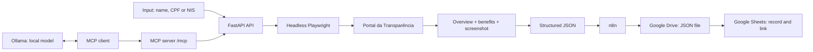

**# RPA — Portal da Transparência

> **Before you start: the two keys in `.env`**
>
> | Variable | What it is | Format | Where to put it |
> |---|---|---|---|
> | `API_KEY` | a password that **you make up** to protect your own API (`localhost:8000`). It does not solve the CAPTCHA. | random text with no spaces, quotes or `#`. Generate it with `openssl rand -hex 32` | in `.env` and in the "API access key" field of the front end (`X-API-Key` header) |
> | `PORTAL_API_KEY` | the **government's** key (gov.br registration, arrives by e-mail). Allows CPF/NIS queries without a CAPTCHA. | exactly as it came in the e-mail, no quotes | **only** in `.env`, never in the front-end field |
>
> ```dotenv
> API_KEY=value_generated_by_you
> REQUIRE_API_KEY=true
> PORTAL_API_KEY=key_received_by_email
> PORTAL_API_MAX_RPM=80
> ```
>
> After editing `.env`, restart the API (`docker compose up -d`). Step-by-step instructions, tests and common errors: [Access keys](#access-keys).

## Deliverables

| Component | Implementation |
|---|---|
| Automation | Python + Playwright driving the official portal |
| Execution | Headless Chromium, isolated context and configurable concurrency |
| Data collection | Person overview and details of Auxílio Brasil, Auxílio Emergencial and Bolsa Família |
| Evidence | PNG screenshot encoded as Base64 inside the JSON |
| API | FastAPI, OpenAPI/Swagger, `X-API-Key` authentication and HTTPS |
| MCP | MCP server at `/mcp` (Streamable HTTP) with the `consultar_pessoa` tool, in the same process as the API |
| Local model | Ollama as a local LLM, connected to the robot through MCP |
| Hyperautomation | n8n with the official Google Drive and Google Sheets nodes |
| Deployment | Docker on a VPS, available over HTTPS on a neutral domain |
| History | PostgreSQL with every query, listed and reopened from the front end |
| Tests | 39 automated tests and structural validation of the n8n workflow |

Application links:

- API: [https://python-rpa-9f3d.72-60-12-215.sslip.io](https://python-rpa-9f3d.72-60-12-215.sslip.io)
- Swagger: [https://python-rpa-9f3d.72-60-12-215.sslip.io/docs](https://python-rpa-9f3d.72-60-12-215.sslip.io/docs)
- OpenAPI: [https://python-rpa-9f3d.72-60-12-215.sslip.io/openapi.json](https://python-rpa-9f3d.72-60-12-215.sslip.io/openapi.json)
- Health check: [https://python-rpa-9f3d.72-60-12-215.sslip.io/health](https://python-rpa-9f3d.72-60-12-215.sslip.io/health)

The query endpoints require a key in the `X-API-Key` header. The evaluation key is shared separately and is not stored in the repository. The `/mcp` endpoint uses the same key. See [Access keys](#access-keys) for the difference between this key and the government key.

## Solution flow



The robot opens the portal's home page, navigates to the people search, enters the term and the social filter, picks the first result and collects the overview. It then opens the details of the benefits required by the assignment, walks through the pagination and returns a single JSON document.

Each query creates a separate browser context. A semaphore limits the number of simultaneous browsers without sharing cookies, pages or data between executions.

The MCP server runs in the same process as the API and calls the same robot, so the semaphore also applies to queries made through MCP. Ollama does not speak MCP by itself: the model decides when to call the tool (tool calling) and an MCP client, which can be the `scripts/chat_ollama.py` script or an n8n agent, performs the call to `/mcp` and returns the result to the model.

## Run locally

Requirements: Python 3.11 or higher, and Node.js only to validate the n8n workflow. [Ollama](https://ollama.com/) is needed only if you want to use the local model.

```bash
python3 -m venv .venv
source .venv/bin/activate
pip install -e '.[test]'
export PLAYWRIGHT_BROWSERS_PATH="$PWD/.browsers"
python -m playwright install chromium
cp .env.example .env
uvicorn app.api:app --host 127.0.0.1 --port 8000
```

To install only the runtime dependencies, without the editable package, use `pip install -r requirements.txt`.

On Windows (PowerShell), activate the environment with `.\.venv\Scripts\Activate.ps1`, set the variable with `$env:PLAYWRIGHT_BROWSERS_PATH = "$PWD\.browsers"` and copy the file with `Copy-Item .env.example .env`.

On Linux, also install Chromium's system dependencies:

```bash
python -m playwright install --with-deps chromium
```

Open `http://127.0.0.1:8000/docs` to use Swagger.

### Command line

```bash
python -m app.cli 'NAME, CPF OR NIS' --output outputs/consulta.json
```

Use `--social` to check the social program beneficiary filter:

```bash
python -m app.cli 'NAME, CPF OR NIS' --social --output outputs/consulta.json
```

The process returns exit code `0` for a complete collection and `2` for a partial result or a structured error.

### API

```bash
curl -X POST http://127.0.0.1:8000/consultas \
  -H 'Content-Type: application/json' \
  -H 'X-API-Key: YOUR_KEY' \
  -d '{"termo":"NAME, CPF OR NIS","beneficiario_programa_social":false}' \
  --output resultado.json
```

`GET /health` checks the API process. The availability of the Portal da Transparência is evaluated during each query.

### History in PostgreSQL

With `DATABASE_URL` set, every `POST /consultas` response (success, partial or error) is written to the `consultas` table, which is created automatically on first use. The full JSON is stored in the `resultado` column (`jsonb`), while the term, name, CPF, NIS, status and date have their own columns for filtering. If the database goes down, queries keep responding normally and the failure only shows up in the log.

| Route | What it does |
|---|---|
| `GET /consultas?limite=20&busca=maria` | Lists the most recent queries (summary), with an optional filter by term or name |
| `GET /consultas/{consulta_id}` | Returns the full JSON of a stored query |

Both routes use the same `X-API-Key` and respond with `503` and `HISTORICO_DESATIVADO` when `DATABASE_URL` is empty. In the front end, card **03 · Previous queries** (*Consultas anteriores*) lists the history; clicking an item reopens the result, with evidence, JSON download and export to Google.

```bash
docker compose exec postgres psql -U observa -c "SELECT consultado_em, termo, nome, status FROM consultas ORDER BY consultado_em DESC LIMIT 10"
```

### MCP

With the API running, the MCP server is available at `http://127.0.0.1:8000/mcp` (Streamable HTTP, stateless), with the `X-API-Key` header. It exposes one tool:

| Tool | Parameters | Description |
|---|---|---|
| `consultar_pessoa` | `termo`, `beneficiario_programa_social` (default `false`), `incluir_evidencia` (default `false`) | Queries the person and returns the same JSON as the [result contract](#result-contract) |

By default the tool returns `evidencia` as `null`, because the Base64 screenshot takes up a lot of space in a local model's context. Use `incluir_evidencia=true` when you need the image. `status`, `codigo` and `mensagem` are preserved.

To test, connect the MCP Inspector to the endpoint:

```bash
npx @modelcontextprotocol/inspector
```

To connect Claude Code:

```bash
claude mcp add --transport http portal-transparencia \
  http://127.0.0.1:8000/mcp \
  --header "X-API-Key: YOUR_KEY"
```

### Local model with Ollama

```bash
ollama serve
ollama pull qwen2.5:7b
```

Use a model that supports tool calling, such as `qwen2.5`, `llama3.1` or `mistral-nemo`. Then, with the API running, open the terminal chat:

```bash
export MCP_URL=http://127.0.0.1:8000/mcp
export MCP_API_KEY=YOUR_KEY
export OLLAMA_MODEL=qwen2.5:7b
python scripts/chat_ollama.py
```

The script lists the MCP server's tools, hands them to the model, executes the requested calls and returns the results until there is a final answer.

In n8n, the same result comes from an **AI Agent** node with **Ollama Chat Model** (Ollama base URL; in Docker, `http://host.docker.internal:11434`) and **MCP Client Tool** pointing to `/mcp` with the `X-API-Key` header.

A query can take up to `QUERY_TIMEOUT_SECONDS`, and the local model's response time adds to that. The queried data stays on your machine or network when the client and Ollama are also local; keep `REQUIRE_API_KEY=true`.

### Everything with one command

Requirements: [Git](https://git-scm.com/), Python 3.11 or higher and [Docker Desktop](https://www.docker.com/products/docker-desktop/) running.

```bash
git clone https://github.com/GeorgeLucas1/rpa-portal-transparencia.git
cd rpa-portal-transparencia
python run.py
```

You don't need to create a `.venv` or install dependencies: `run.py` uses only the Python standard library and the API runs inside the container. It:

1. creates `.env` from `.env.example` if it doesn't exist yet;
2. builds the image and starts the API and n8n (`docker compose up -d --build`);
3. waits for the API (`/health`) and n8n (`/healthz`) to respond;
4. imports the workflow into n8n on the first run;
5. opens `http://127.0.0.1:8000` in the browser and shows the logs.

`Ctrl+C` stops the containers. The first run takes longer because it downloads Chromium; on later runs, use `python run.py --no-build`.

| Command | What it does |
|---|---|
| `python run.py` | API and n8n in containers |
| `python run.py --no-build` | Starts without rebuilding the image |
| `python run.py --no-browser` | Doesn't open the browser |
| `python run.py --local` | API on local Python; n8n and PostgreSQL in containers |
| `python run.py down` | Removes the containers (volumes are kept) |

The `--local` mode is for developing without rebuilding the image after every change. It requires the environment from the [Run locally](#run-locally) section with `.venv` active, installs Chromium into `.browsers` if it's missing and points n8n to `http://host.docker.internal:8000`. If n8n can't reach the API, use `python run.py --local --host 0.0.0.0` with `REQUIRE_API_KEY=true`, since this makes the API visible on the local network.

On Windows, if `python` isn't recognized, use `py run.py`.

### Docker

```bash
docker compose up --build
```

The image includes Python, Chromium and Playwright's system dependencies.

The same `compose.yaml` starts three containers on the `rpa-network` network:

| Service | Address on your computer | Address inside the network |
|---|---|---|
| `api` | `http://127.0.0.1:8000` | `http://api:8000` |
| `n8n` | `http://localhost:5678` | `http://n8n:5678` |
| `postgres` | `127.0.0.1:5432` | `postgres:5432` |

PostgreSQL stores the [query history](#history-in-postgresql) in the `postgres-data` volume; user, password and database come from `POSTGRES_USER`, `POSTGRES_PASSWORD` and `POSTGRES_DB` (default `observa`).

n8n doesn't need to be installed on your computer. The first time, import the workflow inside the container:

```bash
docker compose exec n8n n8n import:workflow --input=/workflows/n8n-consulta-google.json
```

The **Entrada** node uses `RPA_API_URL` (`http://api:8000` in the compose file) and, without that variable, the public API. n8n data and credentials live in the `n8n-data` volume. In Google Cloud, register the OAuth redirect URL `http://localhost:5678/rest/oauth2-credential/callback`.

## Access keys

The project uses **two different keys**, and one does not replace the other:

| Variable in `.env` | What it's for | Who creates it | Where it's used |
|---|---|---|---|
| `API_KEY` | protecting **your** API (`localhost:8000`) | you | `X-API-Key` header: the "API access key" field in the front end, n8n, `curl`, MCP |
| `PORTAL_API_KEY` | querying the **government** Data API by CPF/NIS, without a CAPTCHA | Portal da Transparência, by e-mail | `chave-api-dados` header, sent by the project itself |

Both live in the `.env` file, in the same folder as `compose.yaml`. Create it from the template with `cp .env.example .env` (in PowerShell, `Copy-Item .env.example .env`). `.env` is in `.gitignore` and must not be versioned or shared.

### `API_KEY`: your API's password

It's a password that **you make up**. When it's set, every call to `/consultas`, `/integracoes/...` and `/mcp` must send the same value in the `X-API-Key` header; without it, the response is **401**. It is never sent to the Portal da Transparência and **does not solve the CAPTCHA**.

**When to fill it in.** If you run only on `127.0.0.1`, it's optional. It's mandatory when the API is reachable from other machines: VPS, Easypanel, Render or `--host 0.0.0.0`. In those cases, also use `REQUIRE_API_KEY=true`, so the API refuses to start without a key.

**Format.** Free text, with no spaces, quotes or `#`. A long random value is recommended, for example 64 hexadecimal characters. Generate it with one of these commands:

```bash
openssl rand -hex 32
python -c "import secrets; print(secrets.token_hex(32))"
```

**How to configure it.** In `.env`:

```dotenv
API_KEY=paste_the_generated_value_here
REQUIRE_API_KEY=true
```

Don't use a value copied from examples or documentation: anyone who reads the repository knows it too.

`.env` is only read when the API starts. After editing it, restart: `docker compose up -d` (Docker) or `python run.py --no-build`.

**How to use it.**

- **Front end** (`http://localhost:8000`): open "API access key" (*Chave de acesso da API*) and paste the same value as `API_KEY`. It is valid only for that tab and is not saved.
- **curl**: `-H 'X-API-Key: YOUR_VALUE'` (example in [API](#api)).
- **n8n**: *Header Auth* credential with name `X-API-Key` and the same value (see [Configure and activate the workflow in n8n](#configure-and-activate-the-workflow-in-n8n)).

| `API_KEY` | `REQUIRE_API_KEY` | Behavior |
|---|---|---|
| empty | `false` | accepts calls without a key (local use only) |
| set | any | requires `X-API-Key` equal to the value; otherwise, 401 |
| empty | `true` | the API doesn't start (`API_KEY é obrigatória neste ambiente`, i.e. "API_KEY is required in this environment") |

### `PORTAL_API_KEY`: the government key

This is the key for the Portal da Transparência's official **Data API**. With it, queries by **CPF or NIS** don't open the website and therefore don't hit the AWS WAF CAPTCHA (see [Official alternative: Data API](#official-alternative-data-api)). Search by name still goes through the website.

**How to get it (free).**

1. Go to [portaldatransparencia.gov.br/api-de-dados](https://portaldatransparencia.gov.br/api-de-dados) and choose the registration option.
2. Sign in with your **gov.br** account and confirm your e-mail.
3. The key arrives by e-mail. It's personal: don't share it or create several keys to add up limits.

**Format.** Copy the key **exactly** as it came in the e-mail, with no quotes, spaces or line breaks:

```dotenv
PORTAL_API_KEY=paste_the_key_received_by_email_here
PORTAL_API_MAX_RPM=80
```

`PORTAL_API_MAX_RPM` is the project's cap on requests per minute, set below the official limit (90/min from 06:00 to 23:59; 300/min from 00:00 to 05:59). Restart the API after editing.

**Don't paste this key into the front-end field.** That field is for `API_KEY`; the government key only works in `.env`.

**Test the key** directly against the government API before using it in the project:

```bash
curl -s -o /dev/null -w "%{http_code}\n" \
  -H "chave-api-dados: YOUR_GOV_KEY" \
  "https://api.portaldatransparencia.gov.br/api-de-dados/pessoa-fisica?cpf=YOUR_CPF"
```

`200` means a valid key; `401` or `403` means a wrong key or one that isn't activated yet.

**Check that it was applied.** Run a query by CPF in the front end or at `/consultas`. The result should include `"modo_execucao": "api_oficial"`; if it says `"autonomo"`, the key wasn't loaded. On Docker, check without displaying the value:

```bash
docker compose exec api sh -c 'test -n "$PORTAL_API_KEY" && echo definida || echo vazia'
```

(The command prints `definida` if the key is set and `vazia` if it's empty.)

### Common errors

| Symptom | Likely cause | What to do |
|---|---|---|
| HTTP 401 `Chave de API inválida` | `X-API-Key` differs from `API_KEY` | paste exactly the value from `.env` into the front end/n8n |
| I edited `.env` and nothing changed | API not restarted, or `.env` in another folder | restart; `.env` must sit next to the `compose.yaml` you run `docker compose` from (on WSL, the WSL folder, not the Windows one) |
| CPF returns `PORTAL_BLOQUEADO` (502) | `PORTAL_API_KEY` empty or not loaded | fill it in, restart and check `modo_execucao` |
| `CHAVE_PORTAL_INVALIDA` (502) | the government rejected the key | test it with the `curl` above; check that it was copied in full |
| `LIMITE_API_EXCEDIDO` (429) | the key's per-minute limit was reached | wait a minute; lower `PORTAL_API_MAX_RPM` and `MAX_CONCURRENT`; run large loads overnight |
| name returns `PORTAL_BLOQUEADO` | search by name uses the website, which has a CAPTCHA | query by CPF/NIS |

## Result contract

| Field | Content |
|---|---|
| `consulta_id` | unique UUID of the execution |
| `consultado_em` | UTC date and time |
| `status` | `sucesso`, `parcial` or `erro` |
| `codigo` and `mensagem` | structured diagnostics |
| `pessoa` | name, available CPF/NIS, location and overview |
| `beneficios` | program, URL, extracted pages, completeness and error |
| `evidencia` | MIME type and Base64 screenshot of the overview |
| `etapa` and `duracao_ms` | stage reached and total duration |
| `diagnostico` | URL, title and page capture on an external failure |

The snapshots preserve URL, text, fields and tables as displayed. Missing fields are `null`, monetary values remain textual and the masked CPF is not reconstructed.

HTTP 200 represents a complete or partial collection; the consumer must check `status` and `beneficios[].completo`. The API uses 401 for invalid authentication, 404 for a person not found, 422 for invalid input, 502 for portal blocking/failure and 504 for an exceeded deadline.

## CAPTCHA and automated blocking

The Portal da Transparência may present an AWS WAF human verification depending on network, IP and session. The assignment requires headless automation but does not require solving a CAPTCHA.

When the verification appears, the robot does not try to bypass it. It ends the query with `status=erro`, `codigo=PORTAL_BLOQUEADO` and a diagnostic capture. This handling avoids a silent timeout and prevents incomplete data from being presented as a valid collection.

### Official alternative: Data API

With `PORTAL_API_KEY` filled in (a free key from the gov.br registration at [portaldatransparencia.gov.br/api-de-dados](https://portaldatransparencia.gov.br/api-de-dados)), queries by **CPF/NIS** use the official Data API instead of the website, with no CAPTCHA. The result comes out with `modo_execucao=api_oficial`: the person is retrieved from `/pessoa-fisica` and each benefit indicated there is paginated at the program's endpoint. There is no screenshot, because there is no browser. Search by **name** still goes through the website, since the API doesn't offer it.

The project limits calls to `PORTAL_API_MAX_RPM` per minute. When the API responds with HTTP 429, it waits and retries twice; if the limit persists, it returns `codigo=LIMITE_API_EXCEDIDO` with HTTP 429. A rejected key produces `CHAVE_PORTAL_INVALIDA`.

The selectors and extraction were validated against the real layout in an authorized session. The automated suite uses real Chromium and deterministic local pages, without sending CPFs or names to the government.

## Bonus: n8n, Drive and Sheets

The file [workflows/n8n-consulta-google.json](workflows/n8n-consulta-google.json) contains the complete workflow:

1. the trigger **1. Configurar armazenamento** creates the folder, the spreadsheet and its columns in the connected Google account;
2. the webhook **2. Receber consulta** receives `termo` and `beneficiario_programa_social` and finds those resources by name;
3. it calls `POST /consultas` with `X-API-Key`;
4. it validates the returned contract;
5. it converts the full result into a JSON file;
6. it uploads the file to the created folder with the official **Google Drive** node;
7. it records `consulta_id`, name, CPF, date/time, JSON link, status and code in the official **Google Sheets** node;
8. it returns a receipt with the links to the file and the spreadsheet.

The first trigger is run once after import. Once activated, the workflow runs automatically on every `POST` received by the webhook. No folder or spreadsheet ID is versioned. The file name follows the pattern `CONSULTA_ID_DATE_TIME.json`. OAuth credentials stay in n8n's credential vault and are not exported in the workflow. The Drive file remains private in the Google account; the flow doesn't create any public sharing.

### Configure and activate the workflow in n8n

n8n doesn't read the `workflows/` folder on its own. `python run.py` imports the flow on the first run; without it, import manually:

```bash
docker compose exec n8n n8n import:workflow --input=/workflows/n8n-consulta-google.json
```

The flow arrives **deactivated** and **without credentials**, on purpose: the JSON is public on Git and n8n doesn't activate a flow whose nodes have no credentials. The configuration below is done once and stays saved in the `n8n-data` volume.

**1. Set the API key.** In `.env`, fill in `API_KEY` with your own value and `REQUIRE_API_KEY=true` (format and how to generate it in [Access keys](#access-keys)). Then restart with `python run.py --no-build`.

**2. Create the OAuth client in Google Cloud.**

1. At [console.cloud.google.com](https://console.cloud.google.com), create a project.
2. Under **APIs & Services → Library**, enable the **Google Drive API** and the **Google Sheets API**.
3. Under **OAuth consent screen**, choose **External** and add your Google e-mail as a **test user**.
4. Under **Credentials → Create credentials → OAuth client ID**, choose **Web application** and register the redirect URI `http://localhost:5678/rest/oauth2-credential/callback`.
5. Copy the **Client ID** and the **Client Secret**.

**3. Create the credentials in n8n** (`http://localhost:5678` → **Credentials**):

| Credential | Setup |
|---|---|
| Google Drive OAuth2 API | Client ID and Client Secret; click **Sign in with Google** and sign in to your account |
| Google Sheets OAuth2 API | Same Client ID and Secret; sign in to the same account |
| Header Auth | Name `X-API-Key`; value equal to `API_KEY` in `.env` |

Open the workflow and select the corresponding credential on each node: Google Drive, Google Sheets, **Consultar RPA** and the webhook **2. Receber consulta**.

**4. Prepare the storage.** Run the **1. Configurar armazenamento** trigger once. It creates the folder and the spreadsheet in your Google Drive.

**5. Activate.** Turn on the **Active** switch at the top of the workflow (in newer n8n versions, **Publish**). From then on, every `POST` to the webhook triggers a query:

```bash
curl -X POST http://localhost:5678/webhook/consulta-portal-transparencia \
  -H 'Content-Type: application/json' \
  -H 'X-API-Key: YOUR_KEY' \
  -d '{"termo":"NAME, CPF OR NIS","beneficiario_programa_social":false}'
```

Don't change `"active"` to `true` in the JSON: the flow would be imported active and without credentials, and the webhook would fail on every call.

Editing the JSON in the folder doesn't update the flow that is already in n8n. Since the file has no fixed id, importing again creates a copy. `python run.py down` preserves the `n8n-data` volume, but `docker compose down -v` deletes the flow and the credentials.

Integration details are in [docs/bonus-google.md](docs/bonus-google.md).

## Tests

```bash
source .venv/bin/activate
export PLAYWRIGHT_BROWSERS_PATH="$PWD/.browsers"
python -m pytest -q
node scripts/verify_workflow.cjs
```

The suite covers input and authentication, search by name/document, social filter, first result, three benefits, pagination, Base64 screenshot, no results, WAF blocking, timeout, partial collection, API, isolation of concurrent queries and simulated Google integration.

The Node script validates connections, scripts, JSON file generation, the presence of the official Drive/Sheets nodes, the mapping of the seven columns and the absence of credentials in the versioned artifact.

The MCP tests (`tests/test_mcp.py`) verify that the `consultar_pessoa` tool is listed, that a call without `X-API-Key` is rejected, that evidence is only returned when requested and that `status` is preserved. The robot is mocked, with no access to the portal and no dependency on Ollama.

## Configuration

| Variable | Default | Purpose |
|---|---|---|
| `HEADLESS` | `true` | runs Chromium without a window |
| `MAX_CONCURRENT` | `3` | simultaneous queries per process |
| `QUERY_TIMEOUT_SECONDS` | `120` | total deadline, including queueing |
| `NAVIGATION_TIMEOUT_MS` | `30000` | deadline for Playwright actions |
| `WAF_WAIT_MS` | `8000` | wait for a normal automatic verification |
| `MAX_DETAIL_PAGES` | `100` | page limit per benefit |
| `API_KEY` | empty | value accepted in the `X-API-Key` header |
| `REQUIRE_API_KEY` | `false` | prevents starting without a key when enabled |
| `PORTAL_API_KEY` | empty | gov.br Data API key; with it, CPF/NIS queries use the official API instead of the website |
| `PORTAL_API_MAX_RPM` | `80` | cap on requests per minute to the Data API (official limit: 90/min by day, 300/min overnight) |
| `MCP_ENABLED` | `true` | enables the `/mcp` endpoint |
| `OLLAMA_HOST` | `http://127.0.0.1:11434` | Ollama address, used by `scripts/chat_ollama.py` |
| `OLLAMA_MODEL` | `qwen2.5:7b` | local model, used by `scripts/chat_ollama.py` |
| `MCP_URL` | `http://127.0.0.1:8000/mcp` | MCP server address, used by `scripts/chat_ollama.py` |
| `MCP_API_KEY` | empty | key sent in `X-API-Key` to `/mcp`, used by `scripts/chat_ollama.py` |

The public deployment uses `REQUIRE_API_KEY=true`, HTTPS and a single worker. Concurrency remains configurable through `MAX_CONCURRENT` according to the available memory.

## Project layout

```text
app/
  api.py              API and OpenAPI (mounts MCP at /mcp)
  mcp_server.py       MCP server and the consultar_pessoa tool
  robot.py            browser lifecycle and navigation
  extraction.py       reading the overview, tables and benefits
  models.py           result contract
  cli.py              command-line execution
tests/                unit and Chromium integration tests
workflows/            importable n8n workflow
scripts/              diagnostics, workflow validation and chat_ollama.py
docs/                 bonus architecture, deployment and technical report
```

Query data, screenshots, tokens and local variables are ignored by Git through `.gitignore`. The application does not log the content of responses.**
