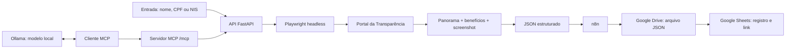

# RPA — Portal da Transparência

> **Antes de começar: as duas chaves do `.env`**
>
> | Variável | O que é | Formato | Onde colocar |
> |---|---|---|---|
> | `API_KEY` | senha que **você inventa** para proteger a sua API (`localhost:8000`). Não resolve o CAPTCHA. | texto aleatório sem espaços, aspas ou `#`. Gere com `openssl rand -hex 32` | no `.env` e no campo "Chave de acesso da API" do front (header `X-API-Key`) |
> | `PORTAL_API_KEY` | chave **do governo** (cadastro gov.br, chega por e-mail). Faz consultas por CPF/NIS sem CAPTCHA. | exatamente como veio no e-mail, sem aspas | **só** no `.env`, nunca no campo do front |
>
> ```dotenv
> API_KEY=valor_gerado_por_voce
> REQUIRE_API_KEY=true
> PORTAL_API_KEY=chave_recebida_por_email
> PORTAL_API_MAX_RPM=80
> ```
>
> Depois de editar o `.env`, reinicie a API (`docker compose up -d`). Passo a passo, testes e erros comuns: [Chaves de acesso](#chaves-de-acesso).

## Entrega

| Componente | Implementação |
|---|---|
| Automação | Python + Playwright controlando o portal oficial |
| Execução | Chromium headless, contexto isolado e concorrência configurável |
| Coleta | Panorama da pessoa e detalhes de Auxílio Brasil, Auxílio Emergencial e Bolsa Família |
| Evidência | Screenshot PNG codificado em Base64 dentro do JSON |
| API | FastAPI, OpenAPI/Swagger, autenticação por `X-API-Key` e HTTPS |
| MCP | Servidor MCP em `/mcp` (Streamable HTTP) com a tool `consultar_pessoa`, no mesmo processo da API |
| Modelo local | Ollama como LLM local, conectado ao robô pelo MCP |
| Hiperautomação | n8n com nós oficiais Google Drive e Google Sheets |
| Implantação | Docker em VPS, disponível por HTTPS em domínio neutro |
| Histórico | PostgreSQL com todas as consultas, listadas e reabertas pelo front |
| Testes | 39 testes automatizados e validação estrutural do workflow n8n |

Links da aplicação:

- API: [https://python-rpa-9f3d.72-60-12-215.sslip.io](https://python-rpa-9f3d.72-60-12-215.sslip.io)
- Swagger: [https://python-rpa-9f3d.72-60-12-215.sslip.io/docs](https://python-rpa-9f3d.72-60-12-215.sslip.io/docs)
- OpenAPI: [https://python-rpa-9f3d.72-60-12-215.sslip.io/openapi.json](https://python-rpa-9f3d.72-60-12-215.sslip.io/openapi.json)
- Health check: [https://python-rpa-9f3d.72-60-12-215.sslip.io/health](https://python-rpa-9f3d.72-60-12-215.sslip.io/health)

Os endpoints de consulta exigem uma chave no cabeçalho `X-API-Key`. A chave de avaliação é compartilhada separadamente e não fica no repositório. O endpoint `/mcp` usa a mesma chave. Veja [Chaves de acesso](#chaves-de-acesso) para a diferença entre essa chave e a chave do governo.

## Fluxo da solução



O robô abre a página inicial do portal, navega até a busca de pessoas, informa o termo e o filtro social, escolhe o primeiro resultado e coleta o panorama. Em seguida, abre os detalhes dos benefícios previstos no enunciado, percorre a paginação e devolve um único documento JSON.

Cada consulta cria um contexto de navegador separado. Um semáforo limita a quantidade de navegadores simultâneos sem compartilhar cookies, páginas ou dados entre execuções.

O servidor MCP roda no mesmo processo da API e chama o mesmo robô, então o semáforo vale também para consultas feitas pelo MCP. O Ollama não fala MCP sozinho: o modelo decide quando chamar a ferramenta (tool calling) e um cliente MCP, que pode ser o script `scripts/chat_ollama.py` ou um agente do n8n, executa a chamada ao `/mcp` e devolve o resultado ao modelo.

## Executar localmente

Requisitos: Python 3.11 ou superior e Node.js apenas para validar o workflow n8n. O [Ollama](https://ollama.com/) é necessário só para usar o modelo local.

```bash
python3 -m venv .venv
source .venv/bin/activate
pip install -e '.[test]'
export PLAYWRIGHT_BROWSERS_PATH="$PWD/.browsers"
python -m playwright install chromium
cp .env.example .env
uvicorn app.api:app --host 127.0.0.1 --port 8000
```

Para instalar só as dependências de execução, sem o pacote em modo editável, use `pip install -r requirements.txt`.

No Windows (PowerShell), ative o ambiente com `.\.venv\Scripts\Activate.ps1`, defina a variável com `$env:PLAYWRIGHT_BROWSERS_PATH = "$PWD\.browsers"` e copie o arquivo com `Copy-Item .env.example .env`.

No Linux, instale também as dependências do Chromium:

```bash
python -m playwright install --with-deps chromium
```

Abra `http://127.0.0.1:8000/docs` para usar o Swagger.

### Linha de comando

```bash
python -m app.cli 'NOME, CPF OU NIS' --output outputs/consulta.json
```

Use `--social` para marcar o filtro de beneficiário de programa social:

```bash
python -m app.cli 'NOME, CPF OU NIS' --social --output outputs/consulta.json
```

O processo retorna código `0` para coleta completa e `2` para resultado parcial ou erro estruturado.

### API

```bash
curl -X POST http://127.0.0.1:8000/consultas \
  -H 'Content-Type: application/json' \
  -H 'X-API-Key: SUA_CHAVE' \
  -d '{"termo":"NOME, CPF OU NIS","beneficiario_programa_social":false}' \
  --output resultado.json
```

`GET /health` verifica o processo da API. A disponibilidade do Portal da Transparência é avaliada durante cada consulta.

### Histórico no PostgreSQL

Com `DATABASE_URL` definido, cada resposta de `POST /consultas` (sucesso, parcial ou erro) é gravada na tabela `consultas`, criada automaticamente no primeiro uso. O JSON completo fica na coluna `resultado` (`jsonb`), e termo, nome, CPF, NIS, status e data ficam em colunas próprias para filtro. Se o banco cair, a consulta continua respondendo normalmente e a falha aparece só no log.

| Rota | O que faz |
|---|---|
| `GET /consultas?limite=20&busca=maria` | Lista as consultas mais recentes (resumo), com filtro opcional por termo ou nome |
| `GET /consultas/{consulta_id}` | Devolve o JSON completo de uma consulta gravada |

As duas rotas usam o mesmo `X-API-Key` e respondem `503` com `HISTORICO_DESATIVADO` quando `DATABASE_URL` está vazio. No front, o cartão **03 · Consultas anteriores** lista o histórico; clicar em um item reabre o resultado, com evidência, download do JSON e exportação para o Google.

```bash
docker compose exec postgres psql -U observa -c "SELECT consultado_em, termo, nome, status FROM consultas ORDER BY consultado_em DESC LIMIT 10"
```

### MCP

Com a API rodando, o servidor MCP fica disponível em `http://127.0.0.1:8000/mcp` (Streamable HTTP, sem estado), com o cabeçalho `X-API-Key`. Ele expõe uma tool:

| Tool | Parâmetros | Descrição |
|---|---|---|
| `consultar_pessoa` | `termo`, `beneficiario_programa_social` (padrão `false`), `incluir_evidencia` (padrão `false`) | Consulta a pessoa e devolve o mesmo JSON do [contrato do resultado](#contrato-do-resultado) |

Por padrão a tool devolve `evidencia` como `null`, porque o screenshot Base64 ocupa muito espaço no contexto de um modelo local. Use `incluir_evidencia=true` quando precisar da imagem. `status`, `codigo` e `mensagem` são preservados.

Para testar, conecte o MCP Inspector ao endpoint:

```bash
npx @modelcontextprotocol/inspector
```

Para conectar o Claude Code:

```bash
claude mcp add --transport http portal-transparencia \
  http://127.0.0.1:8000/mcp \
  --header "X-API-Key: SUA_CHAVE"
```

### Modelo local com Ollama

```bash
ollama serve
ollama pull qwen2.5:7b
```

Use um modelo com suporte a tool calling, como `qwen2.5`, `llama3.1` ou `mistral-nemo`. Depois, com a API rodando, abra o chat no terminal:

```bash
export MCP_URL=http://127.0.0.1:8000/mcp
export MCP_API_KEY=SUA_CHAVE
export OLLAMA_MODEL=qwen2.5:7b
python scripts/chat_ollama.py
```

O script lista as tools do servidor MCP, entrega ao modelo, executa as chamadas pedidas e devolve o resultado até haver a resposta final.

No n8n, o mesmo resultado sai de um nó **AI Agent** com **Ollama Chat Model** (URL base do Ollama; em Docker, `http://host.docker.internal:11434`) e **MCP Client Tool** apontando para `/mcp` com o cabeçalho `X-API-Key`.

Uma consulta pode levar até `QUERY_TIMEOUT_SECONDS`, e a resposta do modelo local soma tempo a isso. Os dados consultados ficam na sua máquina ou rede quando o cliente e o Ollama também são locais; mantenha `REQUIRE_API_KEY=true`.

### Tudo com um comando

Requisitos: [Git](https://git-scm.com/), Python 3.11 ou superior e [Docker Desktop](https://www.docker.com/products/docker-desktop/) aberto.

```bash
git clone https://github.com/GeorgeLucas1/rpa-portal-transparencia.git
cd rpa-portal-transparencia
python run.py
```

Não é preciso criar `.venv` nem instalar dependências: o `run.py` usa só a biblioteca padrão do Python e a API roda dentro do contêiner. Ele:

1. cria o `.env` a partir do `.env.example`, se ainda não existir;
2. constrói a imagem e sobe a API e o n8n (`docker compose up -d --build`);
3. espera a API (`/health`) e o n8n (`/healthz`) responderem;
4. importa o workflow no n8n na primeira execução;
5. abre `http://127.0.0.1:8000` no navegador e mostra os logs.

`Ctrl+C` para os contêineres. A primeira execução demora mais porque baixa o Chromium; nas seguintes, use `python run.py --no-build`.

| Comando | O que faz |
|---|---|
| `python run.py` | API e n8n em contêineres |
| `python run.py --no-build` | Sobe sem reconstruir a imagem |
| `python run.py --no-browser` | Não abre o navegador |
| `python run.py --local` | API no Python local; n8n e PostgreSQL em contêiner |
| `python run.py down` | Remove os contêineres (os volumes são mantidos) |

O modo `--local` serve para desenvolver sem reconstruir a imagem a cada alteração. Ele exige o ambiente da seção [Executar localmente](#executar-localmente) com o `.venv` ativo, instala o Chromium em `.browsers` se faltar e aponta o n8n para `http://host.docker.internal:8000`. Se o n8n não alcançar a API, use `python run.py --local --host 0.0.0.0` com `REQUIRE_API_KEY=true`, porque assim a API fica visível na rede local.

No Windows, se `python` não for reconhecido, use `py run.py`.

### Docker

```bash
docker compose up --build
```

A imagem inclui Python, Chromium e as dependências de sistema do Playwright.

O mesmo `compose.yaml` sobe três contêineres na rede `rpa-network`:

| Serviço | Endereço no computador | Endereço dentro da rede |
|---|---|---|
| `api` | `http://127.0.0.1:8000` | `http://api:8000` |
| `n8n` | `http://localhost:5678` | `http://n8n:5678` |
| `postgres` | `127.0.0.1:5432` | `postgres:5432` |

O PostgreSQL guarda o [histórico das consultas](#histórico-no-postgresql) no volume `postgres-data`; usuário, senha e banco vêm de `POSTGRES_USER`, `POSTGRES_PASSWORD` e `POSTGRES_DB` (padrão `observa`).

O n8n não precisa ser instalado no computador. Na primeira vez, importe o workflow dentro do contêiner:

```bash
docker compose exec n8n n8n import:workflow --input=/workflows/n8n-consulta-google.json
```

O nó **Entrada** usa `RPA_API_URL` (`http://api:8000` no compose) e, sem essa variável, a API pública. Dados e credenciais do n8n ficam no volume `n8n-data`. No Google Cloud, cadastre a URL de retorno OAuth `http://localhost:5678/rest/oauth2-credential/callback`.

## Chaves de acesso

O projeto usa **duas chaves diferentes**, e uma não substitui a outra:

| Variável no `.env` | Para que serve | Quem cria | Onde é usada |
|---|---|---|---|
| `API_KEY` | proteger a **sua** API (`localhost:8000`) | você mesmo | header `X-API-Key`: campo "Chave de acesso da API" do front, n8n, `curl`, MCP |
| `PORTAL_API_KEY` | consultar a API de Dados do **governo** por CPF/NIS, sem CAPTCHA | o Portal da Transparência, por e-mail | header `chave-api-dados`, enviado pelo próprio projeto |

As duas ficam no arquivo `.env`, na mesma pasta do `compose.yaml`. Crie-o a partir do modelo com `cp .env.example .env` (no PowerShell, `Copy-Item .env.example .env`). O `.env` está no `.gitignore` e não deve ser versionado nem compartilhado.

### `API_KEY`: a senha da sua API

É uma senha que **você inventa**. Quando ela está definida, toda chamada a `/consultas`, `/integracoes/...` e `/mcp` precisa enviar o mesmo valor no header `X-API-Key`; sem ele, a resposta é **401**. Ela nunca é enviada ao Portal da Transparência e **não resolve o CAPTCHA**.

**Quando preencher.** Rodando só em `127.0.0.1`, ela é opcional. É obrigatória quando a API fica acessível a outras máquinas: VPS, Easypanel, Render ou `--host 0.0.0.0`. Nesses casos, use também `REQUIRE_API_KEY=true`, para a API se recusar a iniciar sem chave.

**Formato.** Texto livre, sem espaços, sem aspas e sem `#`. Recomenda-se um valor aleatório e longo, por exemplo 64 caracteres hexadecimais. Gere com um destes comandos:

```bash
openssl rand -hex 32
python -c "import secrets; print(secrets.token_hex(32))"
```

**Como configurar.** No `.env`:

```dotenv
API_KEY=cole_aqui_o_valor_gerado
REQUIRE_API_KEY=true
```

Não use um valor copiado de exemplos ou da documentação: quem lê o repositório também o conhece.

O `.env` só é lido quando a API inicia. Depois de editar, reinicie: `docker compose up -d` (Docker) ou `python run.py --no-build`.

**Como usar.**

- **Front** (`http://localhost:8000`): abra "Chave de acesso da API" e cole o mesmo valor do `API_KEY`. Ele vale só para aquela aba e não é salvo.
- **curl**: `-H 'X-API-Key: SEU_VALOR'` (exemplo em [API](#api)).
- **n8n**: credencial *Header Auth* com nome `X-API-Key` e o mesmo valor (ver [Configurar e ativar o workflow no n8n](#configurar-e-ativar-o-workflow-no-n8n)).

| `API_KEY` | `REQUIRE_API_KEY` | Comportamento |
|---|---|---|
| vazia | `false` | aceita chamadas sem chave (só para uso local) |
| preenchida | qualquer | exige `X-API-Key` igual ao valor; senão, 401 |
| vazia | `true` | a API não inicia (`API_KEY é obrigatória neste ambiente`) |

### `PORTAL_API_KEY`: a chave do governo

É a chave da **API de Dados** oficial do Portal da Transparência. Com ela, consultas por **CPF ou NIS** não abrem o site e, por isso, não caem no CAPTCHA do AWS WAF (ver [Alternativa oficial: API de Dados](#alternativa-oficial-api-de-dados)). Busca por nome continua pelo site.

**Como obter (gratuito).**

1. Acesse [portaldatransparencia.gov.br/api-de-dados](https://portaldatransparencia.gov.br/api-de-dados) e escolha a opção de cadastro.
2. Entre com sua conta **gov.br** e confirme o e-mail.
3. A chave chega por e-mail. Ela é pessoal: não a compartilhe nem crie várias para somar limites.

**Formato.** Copie a chave **exatamente** como veio no e-mail, sem aspas, espaços ou quebra de linha:

```dotenv
PORTAL_API_KEY=cole_aqui_a_chave_recebida_por_email
PORTAL_API_MAX_RPM=80
```

`PORTAL_API_MAX_RPM` é o teto de requisições por minuto do projeto, abaixo do limite oficial (90/min das 06:00 às 23:59; 300/min das 00:00 às 05:59). Reinicie a API depois de editar.

**Não cole essa chave no campo do front.** Aquele campo é para a `API_KEY`; a chave do governo só funciona no `.env`.

**Testar a chave** direto na API do governo, antes de usar no projeto:

```bash
curl -s -o /dev/null -w "%{http_code}\n" \
  -H "chave-api-dados: SUA_CHAVE_GOV" \
  "https://api.portaldatransparencia.gov.br/api-de-dados/pessoa-fisica?cpf=SEU_CPF"
```

`200` indica chave válida; `401` ou `403`, chave errada ou ainda não ativada.

**Conferir se foi aplicada.** Faça uma consulta por CPF no front ou em `/consultas`. O resultado deve trazer `"modo_execucao": "api_oficial"`; se vier `"autonomo"`, a chave não foi carregada. No Docker, confira sem exibir o valor:

```bash
docker compose exec api sh -c 'test -n "$PORTAL_API_KEY" && echo definida || echo vazia'
```

### Erros comuns

| Sintoma | Causa provável | O que fazer |
|---|---|---|
| HTTP 401 `Chave de API inválida` | `X-API-Key` diferente do `API_KEY` | cole no front/n8n exatamente o valor do `.env` |
| editei o `.env` e nada mudou | API não reiniciada, ou `.env` em outra pasta | reinicie; o `.env` deve estar ao lado do `compose.yaml` de onde você roda o `docker compose` (no WSL, a pasta do WSL, não a do Windows) |
| CPF retorna `PORTAL_BLOQUEADO` (502) | `PORTAL_API_KEY` vazia ou não carregada | preencha, reinicie e confira `modo_execucao` |
| `CHAVE_PORTAL_INVALIDA` (502) | o governo recusou a chave | teste-a com o `curl` acima; confira se foi copiada inteira |
| `LIMITE_API_EXCEDIDO` (429) | limite por minuto da chave atingido | aguarde um minuto; reduza `PORTAL_API_MAX_RPM` e `MAX_CONCURRENT`; cargas grandes de madrugada |
| nome retorna `PORTAL_BLOQUEADO` | busca por nome usa o site, que tem CAPTCHA | consulte por CPF/NIS |

## Contrato do resultado

| Campo | Conteúdo |
|---|---|
| `consulta_id` | UUID exclusivo da execução |
| `consultado_em` | data e hora UTC |
| `status` | `sucesso`, `parcial` ou `erro` |
| `codigo` e `mensagem` | diagnóstico estruturado |
| `pessoa` | nome, CPF/NIS disponíveis, localidade e panorama |
| `beneficios` | programa, URL, páginas extraídas, completude e erro |
| `evidencia` | MIME type e screenshot Base64 do panorama |
| `etapa` e `duracao_ms` | etapa alcançada e duração total |
| `diagnostico` | URL, título e captura da página em uma falha externa |

Os snapshots preservam URL, texto, campos e tabelas conforme exibidos. Campos ausentes ficam `null`, valores monetários permanecem textuais e o CPF mascarado não é reconstruído.

HTTP 200 representa coleta completa ou parcial; o consumidor deve conferir `status` e `beneficios[].completo`. A API usa 401 para autenticação inválida, 404 para ausência de pessoa, 422 para entrada inválida, 502 para bloqueio/falha do portal e 504 para prazo excedido.

## CAPTCHA e bloqueio automatizado

O Portal da Transparência pode apresentar uma verificação humana do AWS WAF conforme rede, IP e sessão. O enunciado exige automação headless, mas não exige resolver CAPTCHA.

Quando a verificação aparece, o robô não tenta burlá-la. Ele encerra a consulta com `status=erro`, `codigo=PORTAL_BLOQUEADO` e uma captura de diagnóstico. Esse tratamento evita timeout silencioso e impede que dados incompletos sejam apresentados como uma coleta válida.

### Alternativa oficial: API de Dados

Com `PORTAL_API_KEY` preenchida (chave gratuita do cadastro gov.br em [portaldatransparencia.gov.br/api-de-dados](https://portaldatransparencia.gov.br/api-de-dados)), as consultas por **CPF/NIS** usam a API de Dados oficial em vez do site, sem CAPTCHA. O resultado sai com `modo_execucao=api_oficial`: a pessoa vem de `/pessoa-fisica` e cada benefício indicado nela é paginado no endpoint do programa. Não há screenshot, porque não há navegador. Busca por **nome** continua pelo site, já que a API não a oferece.

O projeto limita as chamadas a `PORTAL_API_MAX_RPM` por minuto. Quando a API responde HTTP 429, ele aguarda e repete duas vezes; se o limite persistir, devolve `codigo=LIMITE_API_EXCEDIDO` com HTTP 429. Uma chave recusada gera `CHAVE_PORTAL_INVALIDA`.

Os seletores e a extração foram validados no layout real em sessão autorizada. A suíte automatizada usa Chromium real e páginas locais determinísticas, sem enviar CPFs ou nomes ao governo.

## Bônus: n8n, Drive e Sheets

O arquivo [workflows/n8n-consulta-google.json](workflows/n8n-consulta-google.json) contém o workflow completo:

1. o gatilho **1. Configurar armazenamento** cria a pasta, a planilha e suas colunas na conta Google conectada;
2. o webhook **2. Receber consulta** recebe `termo` e `beneficiario_programa_social` e localiza esses recursos pelo nome;
3. chama `POST /consultas` com `X-API-Key`;
4. valida o contrato retornado;
5. converte o resultado integral em um arquivo JSON;
6. envia o arquivo para a pasta criada com o nó oficial **Google Drive**;
7. registra `consulta_id`, nome, CPF, data/hora, link do JSON, status e código no nó oficial **Google Sheets**;
8. devolve um recibo com os links do arquivo e da planilha.

O primeiro gatilho é executado uma vez após a importação. Depois de ativado, o workflow executa automaticamente a cada `POST` recebido no webhook. Nenhum ID de pasta ou planilha é versionado. O nome do arquivo segue o padrão `CONSULTA_ID_DATA_HORA.json`. As credenciais OAuth ficam no cofre de credenciais do n8n e não são exportadas no workflow. O arquivo do Drive permanece privado na conta Google; o fluxo não cria compartilhamento público.

### Configurar e ativar o workflow no n8n

O n8n não lê a pasta `workflows/` sozinho. O `python run.py` importa o fluxo na primeira execução; sem ele, importe manualmente:

```bash
docker compose exec n8n n8n import:workflow --input=/workflows/n8n-consulta-google.json
```

O fluxo chega **desativado** e **sem credenciais**, de propósito: o JSON é público no Git e o n8n não ativa um fluxo cujos nós não têm credenciais. A configuração abaixo é feita uma vez e fica salva no volume `n8n-data`.

**1. Definir a chave da API.** No `.env`, preencha `API_KEY` com um valor próprio e `REQUIRE_API_KEY=true` (formato e como gerar em [Chaves de acesso](#chaves-de-acesso)). Depois reinicie com `python run.py --no-build`.

**2. Criar o cliente OAuth no Google Cloud.**

1. Em [console.cloud.google.com](https://console.cloud.google.com), crie um projeto.
2. Em **APIs e serviços → Biblioteca**, ative a **Google Drive API** e a **Google Sheets API**.
3. Em **Tela de consentimento OAuth**, escolha **Externo** e adicione o seu e-mail Google como **usuário de teste**.
4. Em **Credenciais → Criar credenciais → ID do cliente OAuth**, escolha **Aplicativo da Web** e cadastre o URI de redirecionamento `http://localhost:5678/rest/oauth2-credential/callback`.
5. Copie o **Client ID** e o **Client Secret**.

**3. Criar as credenciais no n8n** (`http://localhost:5678` → **Credentials**):

| Credencial | Preenchimento |
|---|---|
| Google Drive OAuth2 API | Client ID e Client Secret; clique em **Sign in with Google** e entre na sua conta |
| Google Sheets OAuth2 API | Mesmo Client ID e Secret; entre na mesma conta |
| Header Auth | Nome `X-API-Key`; valor igual ao `API_KEY` do `.env` |

Abra o workflow e selecione a credencial correspondente em cada nó: Google Drive, Google Sheets, **Consultar RPA** e o webhook **2. Receber consulta**.

**4. Preparar o armazenamento.** Execute uma vez o gatilho **1. Configurar armazenamento**. Ele cria a pasta e a planilha no seu Google Drive.

**5. Ativar.** Ligue a chave **Active** no topo do workflow (em versões novas do n8n, **Publish**). A partir daí, cada `POST` no webhook dispara uma consulta:

```bash
curl -X POST http://localhost:5678/webhook/consulta-portal-transparencia \
  -H 'Content-Type: application/json' \
  -H 'X-API-Key: SUA_CHAVE' \
  -d '{"termo":"NOME, CPF OU NIS","beneficiario_programa_social":false}'
```

Não altere `"active"` para `true` no JSON: o fluxo seria importado ativo e sem credenciais, e o webhook falharia em todas as chamadas.

Editar o JSON da pasta não atualiza o fluxo que já está no n8n. Como o arquivo não tem id fixo, importar de novo cria uma cópia. `python run.py down` preserva o volume `n8n-data`, mas `docker compose down -v` apaga o fluxo e as credenciais.

Detalhes da integração estão em [docs/bonus-google.md](docs/bonus-google.md).

## Testes

```bash
source .venv/bin/activate
export PLAYWRIGHT_BROWSERS_PATH="$PWD/.browsers"
python -m pytest -q
node scripts/verify_workflow.cjs
```

A suíte cobre entrada e autenticação, busca por nome/documento, filtro social, primeiro resultado, três benefícios, paginação, screenshot Base64, ausência de resultados, bloqueio WAF, timeout, coleta parcial, API, isolamento de consultas simultâneas e integração Google simulada.

O script Node valida conexões, scripts, geração do arquivo JSON, presença dos nós oficiais Drive/Sheets, mapeamento das sete colunas e ausência de credenciais no artefato versionado.

Os testes do MCP (`tests/test_mcp.py`) verificam que a tool `consultar_pessoa` é listada, que a chamada sem `X-API-Key` é rejeitada, que a evidência só é devolvida quando solicitada e que o `status` é preservado. O robô é simulado, sem acessar o portal e sem depender do Ollama.

## Configuração

| Variável | Padrão | Função |
|---|---|---|
| `HEADLESS` | `true` | executa o Chromium sem janela |
| `MAX_CONCURRENT` | `3` | consultas simultâneas por processo |
| `QUERY_TIMEOUT_SECONDS` | `120` | prazo total, incluindo fila |
| `NAVIGATION_TIMEOUT_MS` | `30000` | prazo das ações Playwright |
| `WAF_WAIT_MS` | `8000` | espera por uma verificação automática normal |
| `MAX_DETAIL_PAGES` | `100` | limite de páginas por benefício |
| `API_KEY` | vazia | valor aceito no cabeçalho `X-API-Key` |
| `REQUIRE_API_KEY` | `false` | impede iniciar sem chave quando ativado |
| `PORTAL_API_KEY` | vazia | chave gov.br da API de Dados; com ela, consultas por CPF/NIS usam a API oficial em vez do site |
| `PORTAL_API_MAX_RPM` | `80` | teto de requisições por minuto à API de Dados (limite oficial: 90/min de dia, 300/min de madrugada) |
| `MCP_ENABLED` | `true` | habilita o endpoint `/mcp` |
| `OLLAMA_HOST` | `http://127.0.0.1:11434` | endereço do Ollama, usado por `scripts/chat_ollama.py` |
| `OLLAMA_MODEL` | `qwen2.5:7b` | modelo local, usado por `scripts/chat_ollama.py` |
| `MCP_URL` | `http://127.0.0.1:8000/mcp` | endereço do servidor MCP, usado por `scripts/chat_ollama.py` |
| `MCP_API_KEY` | vazia | chave enviada em `X-API-Key` ao `/mcp`, usada por `scripts/chat_ollama.py` |

A implantação pública usa `REQUIRE_API_KEY=true`, HTTPS e um único worker. A concorrência continua configurável por `MAX_CONCURRENT` de acordo com a memória disponível.

## Organização

```text
app/
  api.py              API e OpenAPI (monta o MCP em /mcp)
  mcp_server.py       servidor MCP e tool consultar_pessoa
  robot.py            ciclo do navegador e navegação
  extraction.py       leitura do panorama, tabelas e benefícios
  models.py           contrato do resultado
  cli.py              execução em linha de comando
tests/                testes unitários e de integração com Chromium
workflows/            workflow n8n importável
scripts/              diagnósticos, validação do workflow e chat_ollama.py
docs/                 arquitetura do bônus, implantação e relatório técnico
```

Dados de consultas, screenshots, tokens e variáveis locais são ignorados pelo Git por meio de `.gitignore`. A aplicação não registra o conteúdo das respostas nos logs.
