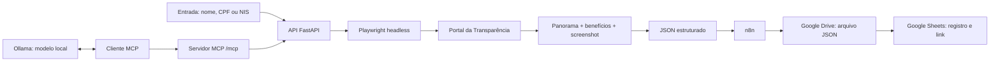

# RPA — Portal da Transparência


## Entrega

| Componente | Implementação |
|---|---|
| Automação | Python + Playwright controlando o portal oficial |
| Execução | Chromium headless, contexto isolado e concorrência configurável |
| Coleta | Panorama da pessoa e detalhes de Auxílio Brasil, Auxílio Emergencial e Bolsa Família |
| Evidência | Screenshot PNG codificado em Base64 dentro do JSON |
| API | FastAPI, OpenAPI/Swagger, autenticação por `X-API-Key` e HTTPS |
| MCP | Servidor MCP em `/mcp` (Streamable HTTP) com a tool `consultar_pessoa`, no mesmo processo da API |
| Modelo local | Ollama como LLM local, conectado ao robô pelo MCP |
| Hiperautomação | n8n com nós oficiais Google Drive e Google Sheets |
| Implantação | Docker em VPS, disponível por HTTPS em domínio neutro |
| Testes | 36 testes automatizados e validação estrutural do workflow n8n |

Links da aplicação:

- API: [https://python-rpa-9f3d.72-60-12-215.sslip.io](https://python-rpa-9f3d.72-60-12-215.sslip.io)
- Swagger: [https://python-rpa-9f3d.72-60-12-215.sslip.io/docs](https://python-rpa-9f3d.72-60-12-215.sslip.io/docs)
- OpenAPI: [https://python-rpa-9f3d.72-60-12-215.sslip.io/openapi.json](https://python-rpa-9f3d.72-60-12-215.sslip.io/openapi.json)
- Health check: [https://python-rpa-9f3d.72-60-12-215.sslip.io/health](https://python-rpa-9f3d.72-60-12-215.sslip.io/health)

Os endpoints de consulta exigem uma chave no cabeçalho `X-API-Key`. A chave de avaliação é compartilhada separadamente e não fica no repositório. O endpoint `/mcp` usa a mesma chave.

## Fluxo da solução



O robô abre a página inicial do portal, navega até a busca de pessoas, informa o termo e o filtro social, escolhe o primeiro resultado e coleta o panorama. Em seguida, abre os detalhes dos benefícios previstos no enunciado, percorre a paginação e devolve um único documento JSON.

Cada consulta cria um contexto de navegador separado. Um semáforo limita a quantidade de navegadores simultâneos sem compartilhar cookies, páginas ou dados entre execuções.

O servidor MCP roda no mesmo processo da API e chama o mesmo robô, então o semáforo vale também para consultas feitas pelo MCP. O Ollama não fala MCP sozinho: o modelo decide quando chamar a ferramenta (tool calling) e um cliente MCP, que pode ser o script `scripts/chat_ollama.py` ou um agente do n8n, executa a chamada ao `/mcp` e devolve o resultado ao modelo.

## Executar localmente

Requisitos: Python 3.11 ou superior e Node.js apenas para validar o workflow n8n. O [Ollama](https://ollama.com/) é necessário só para usar o modelo local.

```bash
python3 -m venv .venv
source .venv/bin/activate
pip install -e '.[test]'
export PLAYWRIGHT_BROWSERS_PATH="$PWD/.browsers"
python -m playwright install chromium
cp .env.example .env
uvicorn app.api:app --host 127.0.0.1 --port 8000
```

No Linux, instale também as dependências do Chromium:

```bash
python -m playwright install --with-deps chromium
```

Abra `http://127.0.0.1:8000/docs` para usar o Swagger.

### Linha de comando

```bash
python -m app.cli 'NOME, CPF OU NIS' --output outputs/consulta.json
```

Use `--social` para marcar o filtro de beneficiário de programa social:

```bash
python -m app.cli 'NOME, CPF OU NIS' --social --output outputs/consulta.json
```

O processo retorna código `0` para coleta completa e `2` para resultado parcial ou erro estruturado.

### API

```bash
curl -X POST http://127.0.0.1:8000/consultas \
  -H 'Content-Type: application/json' \
  -H 'X-API-Key: SUA_CHAVE' \
  -d '{"termo":"NOME, CPF OU NIS","beneficiario_programa_social":false}' \
  --output resultado.json
```

`GET /health` verifica o processo da API. A disponibilidade do Portal da Transparência é avaliada durante cada consulta.

### MCP

Com a API rodando, o servidor MCP fica disponível em `http://127.0.0.1:8000/mcp` (Streamable HTTP, sem estado), com o cabeçalho `X-API-Key`. Ele expõe uma tool:

| Tool | Parâmetros | Descrição |
|---|---|---|
| `consultar_pessoa` | `termo`, `beneficiario_programa_social` (padrão `false`), `incluir_evidencia` (padrão `false`) | Consulta a pessoa e devolve o mesmo JSON do [contrato do resultado](#contrato-do-resultado) |

Por padrão a tool devolve `evidencia` como `null`, porque o screenshot Base64 ocupa muito espaço no contexto de um modelo local. Use `incluir_evidencia=true` quando precisar da imagem. `status`, `codigo` e `mensagem` são preservados.

Para testar, conecte o MCP Inspector ao endpoint:

```bash
npx @modelcontextprotocol/inspector
```

Para conectar o Claude Code:

```bash
claude mcp add --transport http portal-transparencia \
  http://127.0.0.1:8000/mcp \
  --header "X-API-Key: SUA_CHAVE"
```

### Modelo local com Ollama

```bash
ollama serve
ollama pull qwen2.5:7b
```

Use um modelo com suporte a tool calling, como `qwen2.5`, `llama3.1` ou `mistral-nemo`. Depois, com a API rodando, abra o chat no terminal:

```bash
export MCP_URL=http://127.0.0.1:8000/mcp
export MCP_API_KEY=SUA_CHAVE
export OLLAMA_MODEL=qwen2.5:7b
python scripts/chat_ollama.py
```

O script lista as tools do servidor MCP, entrega ao modelo, executa as chamadas pedidas e devolve o resultado até haver a resposta final.

No n8n, o mesmo resultado sai de um nó **AI Agent** com **Ollama Chat Model** (URL base do Ollama; em Docker, `http://host.docker.internal:11434`) e **MCP Client Tool** apontando para `/mcp` com o cabeçalho `X-API-Key`.

Uma consulta pode levar até `QUERY_TIMEOUT_SECONDS`, e a resposta do modelo local soma tempo a isso. Os dados consultados ficam na sua máquina ou rede quando o cliente e o Ollama também são locais; mantenha `REQUIRE_API_KEY=true`.

### Docker

```bash
docker compose up --build
```

A imagem inclui Python, Chromium e as dependências de sistema do Playwright.

## Contrato do resultado

| Campo | Conteúdo |
|---|---|
| `consulta_id` | UUID exclusivo da execução |
| `consultado_em` | data e hora UTC |
| `status` | `sucesso`, `parcial` ou `erro` |
| `codigo` e `mensagem` | diagnóstico estruturado |
| `pessoa` | nome, CPF/NIS disponíveis, localidade e panorama |
| `beneficios` | programa, URL, páginas extraídas, completude e erro |
| `evidencia` | MIME type e screenshot Base64 do panorama |
| `etapa` e `duracao_ms` | etapa alcançada e duração total |
| `diagnostico` | URL, título e captura da página em uma falha externa |

Os snapshots preservam URL, texto, campos e tabelas conforme exibidos. Campos ausentes ficam `null`, valores monetários permanecem textuais e o CPF mascarado não é reconstruído.

HTTP 200 representa coleta completa ou parcial; o consumidor deve conferir `status` e `beneficios[].completo`. A API usa 401 para autenticação inválida, 404 para ausência de pessoa, 422 para entrada inválida, 502 para bloqueio/falha do portal e 504 para prazo excedido.

## CAPTCHA e bloqueio automatizado

O Portal da Transparência pode apresentar uma verificação humana do AWS WAF conforme rede, IP e sessão. O enunciado exige automação headless, mas não exige resolver CAPTCHA.

Quando a verificação aparece, o robô não tenta burlá-la. Ele encerra a consulta com `status=erro`, `codigo=PORTAL_BLOQUEADO` e uma captura de diagnóstico. Esse tratamento evita timeout silencioso e impede que dados incompletos sejam apresentados como uma coleta válida.

Os seletores e a extração foram validados no layout real em sessão autorizada. A suíte automatizada usa Chromium real e páginas locais determinísticas, sem enviar CPFs ou nomes ao governo.

## Bônus: n8n, Drive e Sheets

O arquivo [workflows/n8n-consulta-google.json](workflows/n8n-consulta-google.json) contém o workflow completo:

1. o gatilho **1. Configurar armazenamento** cria a pasta, a planilha e suas colunas na conta Google conectada;
2. o webhook **2. Receber consulta** recebe `termo` e `beneficiario_programa_social` e localiza esses recursos pelo nome;
3. chama `POST /consultas` com `X-API-Key`;
4. valida o contrato retornado;
5. converte o resultado integral em um arquivo JSON;
6. envia o arquivo para a pasta criada com o nó oficial **Google Drive**;
7. registra `consulta_id`, nome, CPF, data/hora, link do JSON, status e código no nó oficial **Google Sheets**;
8. devolve um recibo com os links do arquivo e da planilha.

O primeiro gatilho é executado uma vez após a importação. Depois de ativado, o workflow executa automaticamente a cada `POST` recebido no webhook. Nenhum ID de pasta ou planilha é versionado. O nome do arquivo segue o padrão `CONSULTA_ID_DATA_HORA.json`. As credenciais OAuth ficam no cofre de credenciais do n8n e não são exportadas no workflow. O arquivo do Drive permanece privado na conta Google; o fluxo não cria compartilhamento público.

Detalhes da integração estão em [docs/bonus-google.md](docs/bonus-google.md).

## Testes

```bash
source .venv/bin/activate
export PLAYWRIGHT_BROWSERS_PATH="$PWD/.browsers"
python -m pytest -q
node scripts/verify_workflow.cjs
```

A suíte cobre entrada e autenticação, busca por nome/documento, filtro social, primeiro resultado, três benefícios, paginação, screenshot Base64, ausência de resultados, bloqueio WAF, timeout, coleta parcial, API, isolamento de consultas simultâneas e integração Google simulada.

O script Node valida conexões, scripts, geração do arquivo JSON, presença dos nós oficiais Drive/Sheets, mapeamento das sete colunas e ausência de credenciais no artefato versionado.

Os testes do MCP (`tests/test_mcp.py`) verificam que a tool `consultar_pessoa` é listada, que a chamada sem `X-API-Key` é rejeitada, que a evidência só é devolvida quando solicitada e que o `status` é preservado. O robô é simulado, sem acessar o portal e sem depender do Ollama.

## Configuração

| Variável | Padrão | Função |
|---|---|---|
| `HEADLESS` | `true` | executa o Chromium sem janela |
| `MAX_CONCURRENT` | `3` | consultas simultâneas por processo |
| `QUERY_TIMEOUT_SECONDS` | `120` | prazo total, incluindo fila |
| `NAVIGATION_TIMEOUT_MS` | `30000` | prazo das ações Playwright |
| `WAF_WAIT_MS` | `8000` | espera por uma verificação automática normal |
| `MAX_DETAIL_PAGES` | `100` | limite de páginas por benefício |
| `API_KEY` | vazia | valor aceito no cabeçalho `X-API-Key` |
| `REQUIRE_API_KEY` | `false` | impede iniciar sem chave quando ativado |
| `MCP_ENABLED` | `true` | habilita o endpoint `/mcp` |
| `OLLAMA_HOST` | `http://127.0.0.1:11434` | endereço do Ollama, usado por `scripts/chat_ollama.py` |
| `OLLAMA_MODEL` | `qwen2.5:7b` | modelo local, usado por `scripts/chat_ollama.py` |
| `MCP_URL` | `http://127.0.0.1:8000/mcp` | endereço do servidor MCP, usado por `scripts/chat_ollama.py` |
| `MCP_API_KEY` | vazia | chave enviada em `X-API-Key` ao `/mcp`, usada por `scripts/chat_ollama.py` |

A implantação pública usa `REQUIRE_API_KEY=true`, HTTPS e um único worker. A concorrência continua configurável por `MAX_CONCURRENT` de acordo com a memória disponível.

## Organização

```text
app/
  api.py              API e OpenAPI (monta o MCP em /mcp)
  mcp_server.py       servidor MCP e tool consultar_pessoa
  robot.py            ciclo do navegador e navegação
  extraction.py       leitura do panorama, tabelas e benefícios
  models.py           contrato do resultado
  cli.py              execução em linha de comando
tests/                testes unitários e de integração com Chromium
workflows/            workflow n8n importável
scripts/              diagnósticos, validação do workflow e chat_ollama.py
docs/                 arquitetura do bônus, implantação e relatório técnico
```

Dados de consultas, screenshots, tokens e variáveis locais são ignorados pelo Git por meio de `.gitignore`. A aplicação não registra o conteúdo das respostas nos logs.
