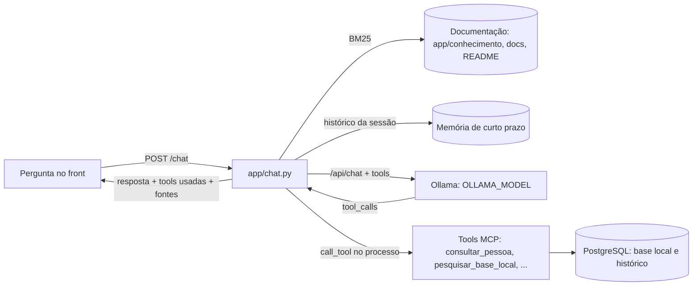

# Mini chat do Observa

O front tem um assistente no canto inferior direito (**✦ Assistente**). Você digita uma pergunta e um modelo local do Ollama responde usando as tools MCP do Observa, trechos da documentação (RAG) e o que foi conversado antes (memória de curto prazo).



## Usar no front

- **✦ Assistente** abre o chat; **✕** ou `Esc` fecha.
- **i** (ao lado do título) mostra todas as tools do servidor MCP, com descrição e parâmetros (`*` = obrigatório). As marcadas **no chat** o assistente chama sozinho; as marcadas **só MCP / front** (importar e cancelar importações) ficam com o cartão Base local e com clientes MCP como o Claude Code.
- `Enter` envia, `Shift+Enter` quebra a linha. As sugestões iniciais enviam a pergunta com um clique.
- Embaixo de cada resposta aparecem as tools que o modelo chamou (`↳ consultar_pessoa(termo: "…")`, em vermelho se deram erro) e **Fontes da documentação**; as citadas no texto aparecem como `¹`, `²`.
- **↺ Nova conversa** apaga a memória da sessão no servidor e limpa a tela.

## Como funciona

### Tools MCP

O chat usa as mesmas tools de `/mcp`, chamadas no próprio processo (`MCPServer.call_tool`), sem passar por HTTP; funciona mesmo com `MCP_ENABLED=false`. O modelo recebe só as tools de leitura:

| Tool | No chat |
|---|---|
| `consultar_pessoa` | sim |
| `pesquisar_base_local` | sim |
| `listar_base_local` | sim |
| `status_importacao` | sim |
| `importar_base_local` | não: baixa centenas de MB; fica com o cartão Base local e clientes MCP |
| `cancelar_importacao` | não |

Se o modelo pedir uma tool fora da lista, a chamada é recusada e ele recebe a explicação. Argumentos inválidos voltam ao modelo como erro, para ele corrigir. São até 5 rodadas de tools por pergunta. O JSON de cada tool é compactado antes de ir ao modelo (tabelas cortadas em 6 linhas, até 6 meses por programa, sem screenshot, no máximo 12 mil caracteres). Especificação das tools: [mcp.md](mcp.md).

### RAG

A pergunta é procurada por **BM25** (busca lexical, sem modelo de embeddings) em:

- `app/conhecimento/*.md`: base escrita para o assistente, em português (programas, CPF mascarado, campos do resultado, por que uma pessoa não aparece, como importar, chaves);
- `docs/*.md` e `README.md`.

Cada seção `##`/`###` vira um trecho (seções longas são divididas). Os 3 melhores trechos entram no prompt de sistema como `[1]`, `[2]`, `[3]`; trechos com menos de 35% da pontuação do melhor são descartados. Em perguntas curtas ("e o BPC?"), a pergunta anterior entra na busca. O índice é montado no primeiro uso e fica em memória.

Para ensinar algo novo ao assistente, acrescente uma seção em `app/conhecimento/observa.md` (ou um novo `.md` na pasta) e reinicie a API. A imagem Docker copia `README.md` e `docs/` para que o RAG funcione no contêiner.

### Memória de curto prazo

- Cada conversa tem um `sessao_id` (o front guarda no `sessionStorage` da aba).
- O servidor guarda as últimas `CHAT_MEMORY_TURNS` trocas (padrão 6) de cada sessão: pergunta, chamadas de tools, resultados (cortados em 1.500 caracteres) e resposta. Isso permite continuações como "e quanto ela recebeu?".
- A sessão é esquecida depois de `CHAT_MEMORY_MINUTES` sem uso (padrão 30), em **Nova conversa** (`DELETE /chat/{sessao_id}`) ou quando a API reinicia. No máximo 200 sessões ficam em memória; a mais antiga sai primeiro.
- `CHAT_MEMORY_TURNS=0` desliga a memória.

## API

Todas com `X-API-Key`; aparecem no Swagger na seção **Chat**.

| Rota | Corpo / resposta |
|---|---|
| `GET /chat/ferramentas` | `{modelo, memoria_turnos, ferramentas: [{nome, descricao, no_chat, parametros: [{nome, tipo, obrigatorio, descricao}]}]}` |
| `POST /chat` | corpo `{mensagem, sessao_id?}` → `{sessao_id, resposta, ferramentas: [{nome, argumentos, status}], fontes: [{n, titulo, arquivo, citada}], memoria_turnos, modelo}` |
| `DELETE /chat/{sessao_id}` | `{sessao_id, esquecida}` |

```bash
curl -s http://127.0.0.1:8000/chat -H "X-API-Key: SUA_CHAVE" -H "Content-Type: application/json" \
  -d '{"mensagem": "Quais meses estão importados?"}'
```

Erros (`{codigo, mensagem}`):

| Código | HTTP | Quando |
|---|---|---|
| `CHAT_INDISPONIVEL` | 503 | o Ollama não respondeu em `OLLAMA_HOST` |
| `MODELO_AUSENTE` | 503 | o modelo não foi baixado (`ollama pull <modelo>`) |
| `MODELO_SEM_TOOLS` | 503 | o modelo não suporta tool calling |
| `CHAT_TEMPO_ESGOTADO` | 504 | passou de `CHAT_TIMEOUT_SECONDS` |
| `CHAT_DESATIVADO` | 503 | `CHAT_ENABLED=false` |

## Configuração

| Variável | Padrão | Uso |
|---|---|---|
| `CHAT_ENABLED` | `true` | liga as rotas `/chat` |
| `OLLAMA_HOST` | `http://127.0.0.1:11434` (no compose: `http://host.docker.internal:11434`) | endereço do Ollama |
| `OLLAMA_MODEL` | `qwen2.5:7b` | modelo com suporte a tools (`qwen2.5`, `llama3.1`, `mistral-nemo`) |
| `CHAT_TIMEOUT_SECONDS` | `180` | tempo máximo de cada chamada ao modelo |
| `CHAT_MEMORY_TURNS` | `6` | trocas lembradas por sessão |
| `CHAT_MEMORY_MINUTES` | `30` | minutos sem uso até esquecer a sessão |

```bash
ollama serve
ollama pull qwen2.5:7b
```

**Hardware.** Um modelo de 7–8B precisa de uns 6 GB de RAM livre (ou GPU) para responder em segundos. Com pouca memória o Ollama nem carrega o modelo e a pergunta termina em `CHAT_TEMPO_ESGOTADO`; use um modelo menor com tools (ex.: `qwen2.5:3b`, `llama3.2:3b`) ou rode o Ollama em outra máquina e aponte `OLLAMA_HOST` para ela.

## Privacidade

Pergunta, resultados das tools e documentação vão só para o Ollama configurado. Com Ollama local, nada sai da máquina. A memória fica na RAM do processo da API e não é gravada em disco nem no PostgreSQL.

## Testes

`tests/test_chat.py` simula o Ollama com `httpx.MockTransport` e cobre: busca do RAG e divisão do Markdown, compactação do JSON das tools, a lista do botão "i", uma conversa com duas tools seguida de uma pergunta que usa a memória e cita a documentação, o limite de trocas lembradas, a recusa de tools fora do chat, argumentos inválidos e os erros do Ollama. `tests/test_ui.py` abre o chat no navegador, usa o "i", envia perguntas na mesma sessão e começa uma nova conversa.
